  

I came to NLP from economics by way of linguistics, and I'm still more interested in language than in benchmarks.

**What I work on**
- Old Chinese phonology: finding phonological evidence in scholarly literature with weak supervision and small local models
- Oracle-bone script: multimodal modelling of rubbings, tracings and text
- Inductive bias in small-data NLP: what simple features crowd out

**Off-hours**: Crusader Kings III modding, fiction, Irish history, theatre.

*Repositories are private for now; more to come.*
